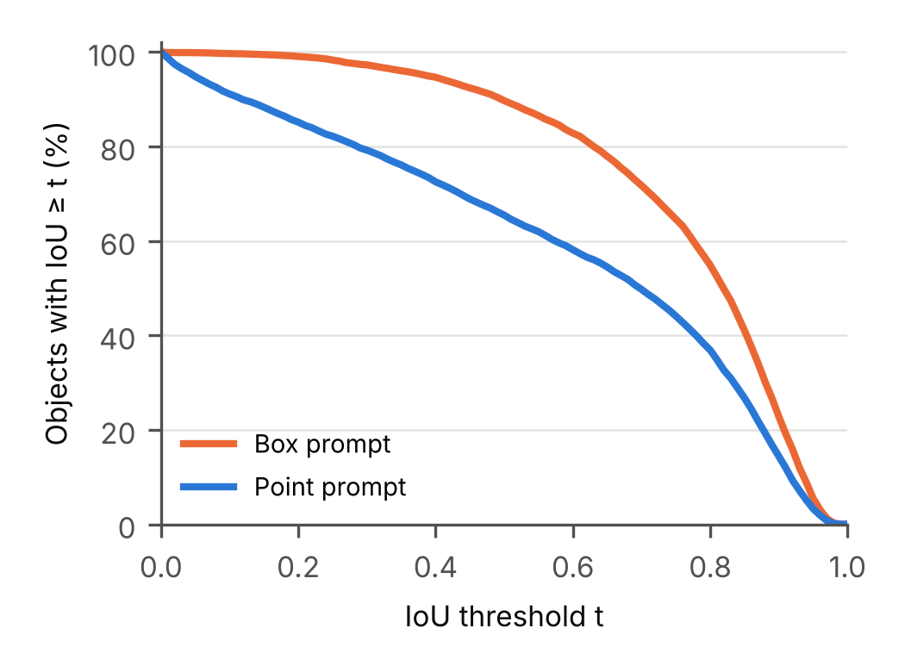
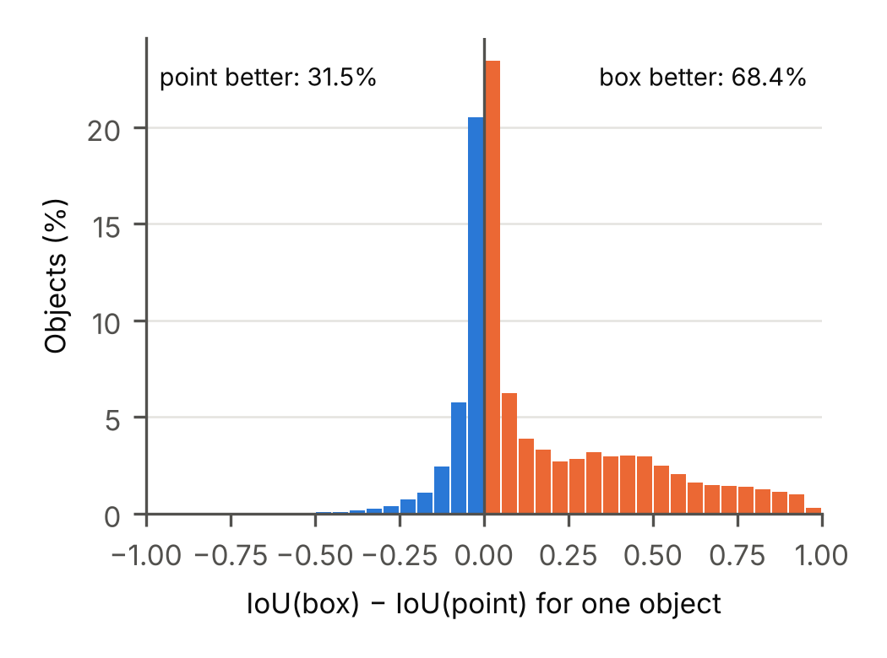

# Comparison of Point and Box Prompts

Both prompts were evaluated on the same 6,941 object instances from the 991 test images, so every object has one IoU value for the point prompt and one for the box prompt. This section looks beyond the mean values and asks where the box helps, how much, and where it does not help.

## Quality levels

Table 1 shows the share of objects that reach a given IoU. With a box, 89.7% of the objects reach IoU ≥ 0.5, compared with 65.5% for a single point. The box curve in Figure 1 lies above the point curve for every threshold. The gap is largest for thresholds around 0.5 to 0.6 (about 24 to 25 percentage points) and becomes small near 1.0, where both prompts fail to reach an almost perfect mask. This suggests that the box mainly removes large errors and helps less with fine boundary details. The difference is clearest for almost wrong masks: 20.8% of the point masks have IoU below 0.3, but only 2.7% of the box masks.

**Table 1.** Share of objects above an IoU threshold (test split).

| IoU threshold | Point (%) | Box (%) | Difference (pp) |
|---|---:|---:|---:|
| ≥ 0.5 | 65.5 | 89.7 | +24.2 |
| ≥ 0.75 | 44.1 | 64.6 | +20.5 |
| ≥ 0.9 | 14.4 | 22.8 | +8.4 |

**Figure 1.** Share of test objects with IoU ≥ t for each threshold t.

## Paired differences

The box gives a higher IoU for 68.4% of the objects, but the paired differences are not symmetric (Figure 2). For 44.0% of the objects the two prompts differ by at most 0.05. When the point wins, it usually wins by a small margin: the point is better by more than 0.1 for only 5.2% of the objects and by more than 0.3 for 0.6%. When the box wins, the margin is often large: it is better by more than 0.1 for 38.8% and by more than 0.3 for 26.1% of the objects. So the two prompts give similar masks for many objects, and the mean gain of the box comes mostly from objects where the point mask is very poor.

**Figure 2.** Distribution of the paired difference IoU(box) − IoU(point) over all test objects.

## Object size

The gain of the box grows with object size (Table 2). For small objects (area below 32² pixels) the box adds only 0.074 mean IoU and is better for 54.6% of them. For large objects (area at least 96² pixels) it adds 0.296 and is better for 84.1%. The point performs worst on large objects (mean IoU 0.548). The median ratio of predicted to ground-truth area is 0.71 for large objects with a point and 0.98 with a box, so the point mask usually covers only a part of a large object. The box shows the full extent of the object and removes this part-versus-whole ambiguity. For small objects the box masks are often too large (median area ratio 1.31), so they include background or nearby objects. For a small object, a few extra pixels already cost a lot of IoU.

**Table 2.** Mean IoU by object size (COCO area groups, test split).

| Size | Objects | Point | Box | Difference | Box better (%) |
|---|---:|---:|---:|---:|---:|
| Small | 2782 | 0.592 | 0.666 | +0.074 | 54.6 |
| Medium | 2370 | 0.651 | 0.812 | +0.161 | 72.8 |
| Large | 1789 | 0.548 | 0.844 | +0.296 | 84.1 |

## Categories

Among the 64 categories with at least 30 test objects, the largest gains are for big objects that consist of several distinct parts, such as train (+0.506), bus (+0.414), toilet (+0.325), keyboard (+0.322) and couch (+0.317). A point on one part of a train often gives a mask of only that part. The smallest gains are for thin or elongated objects: spoon (+0.039), umbrella (+0.036), tennis racket (+0.030), zebra (+0.017) and baseball bat (−0.019). Baseball bat is the only one of these 64 categories where the point is better on average. For thin objects most of the tight box is background, so the box gives little extra information, while a point placed on the object already identifies it well.

## Summary

The box prompt is better overall and, more importantly, much more reliable: it rarely produces an almost wrong mask. Its advantage is largest for large and multi-part objects, where a single point is ambiguous. For small and thin objects the two prompts give similar quality, and the point can be slightly better. These boxes come from the ground truth, so the results show the gain of a perfectly placed box. A box drawn by a real user or produced by a detector would be less precise, and the gain could be smaller.
